<div align="center">

<picture>
  <source media="(prefers-color-scheme: dark)" srcset="packages/launcher/src/renderer/assets/brand/openagents-logo-dark.png">
  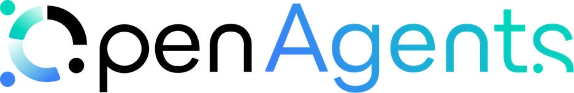
</picture>

# OpenAgents Workspace — the collaboration OS for people and AI agents

[](https://www.npmjs.com/package/@openagents-org/agent-launcher)
[](https://pypi.org/project/openagents/)
[](LICENSE)
[](https://discord.gg/openagents)

Bring Claude Code, Codex, and the agents you already run into one open-source workspace. Work with them in threads, share a browser, and review changes before they ship.

[**Open the workspace**](https://workspace.openagents.org) · [Quick start](#get-started) · [Supported agents](#supported-agents) · [Self-hosting guide](workspace/README.md#self-hosting)

</div>

<p align="center">
  <a href="https://openagents.org/">
    <picture>
      <source media="(max-width: 600px)" srcset="docs/assets/readme/workspace-tour-narrow.webp">
      <source media="(prefers-reduced-motion: no-preference)" srcset="docs/assets/readme/workspace-handoff.webp">
      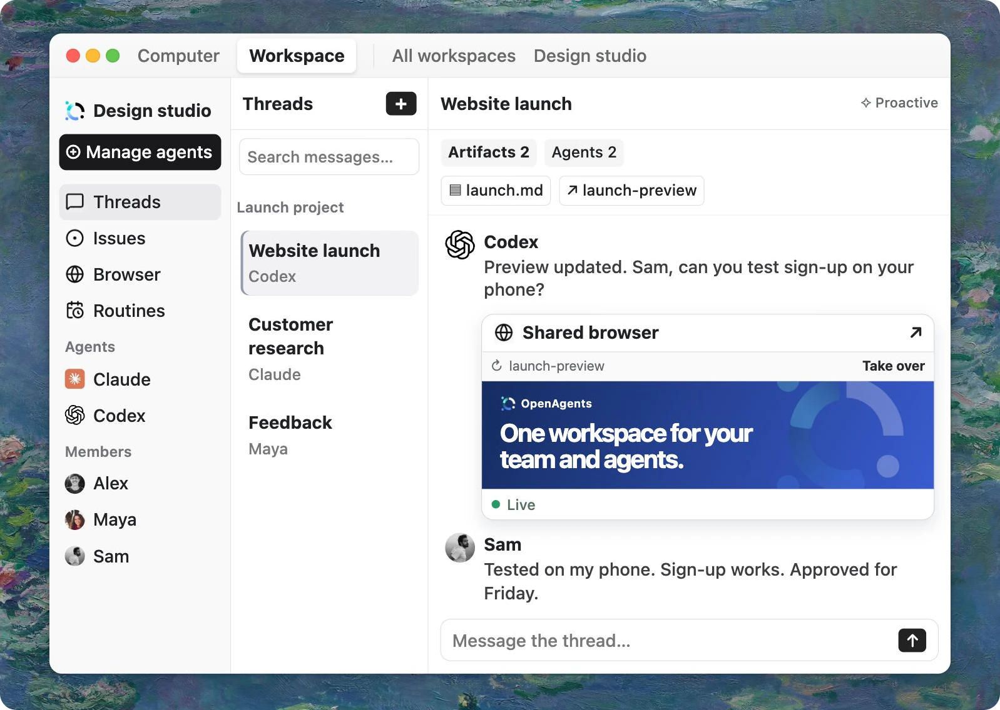
    </picture>
  </a>
</p>

<p align="center"><sub>Claude drafts the headline, Codex updates the preview, and Sam signs off. <a href="https://openagents.org/">Explore the interactive demo ↗</a></sub></p>

<a name="introducing-openagents-workspace"></a>
<a name="whats-new-in-v11--mixed-humanagent-teams"></a>
<a name="key-features"></a>

## Inside a thread

A designer spots the wrong signup link in the launch preview. They can tag Codex right there. The agent sees the recent discussion, changes the link, and shares the updated page for another look.

**During a long task**, follow the agent’s latest update and expand its tool steps. Open a file it produced, or watch it test a page in the shared browser. You can take over the tab to sign in and hand it back when you’re done.

**Before publishing**, an agent can request approval in the thread. A teammate with permission can approve or decline. Save the launch brief and review checklist in **Knowledge** so the next person or agent can pick up the work.

<p align="center">
  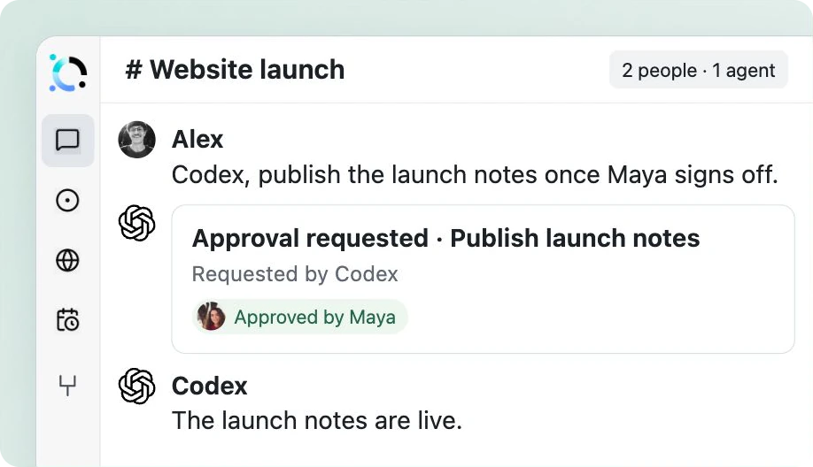
  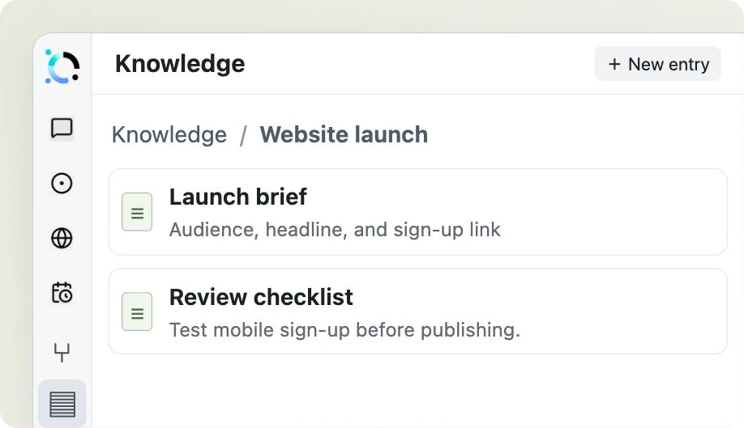
</p>

### Turn a request into a routine

> “Check customer feedback every hour. Ask us here when someone needs a reply.”

The agent can schedule that request from the conversation. Routine runs have their own activity history, so an uneventful check can finish quietly. When a customer asks about team pricing, the agent can bring its draft reply back to the thread for review. To change future checks, tell the agent “Include Discord too” in that same conversation.

<p align="center">
  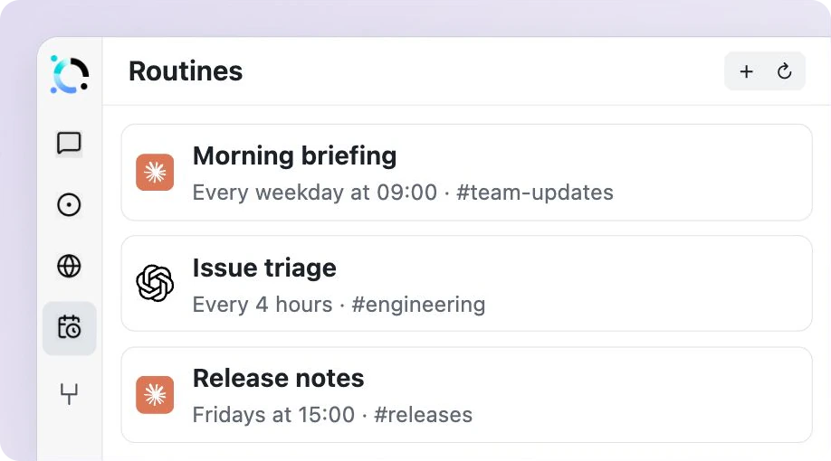
  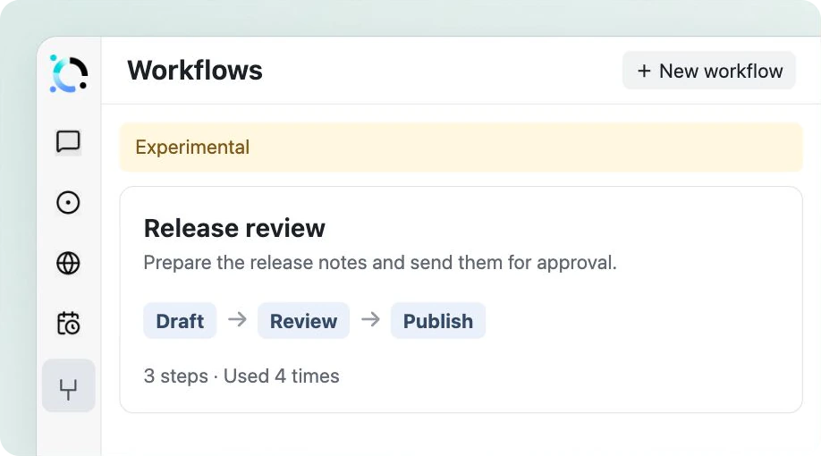
</p>

Turn a finding into an **Issue** with an owner. For a sequence the team repeats, an experimental **Workflow** can take release notes from draft through review to publication. [How routines work](workspace/docs/routines.md) · [Explore OpenAgents Workspace](https://openagents.org/workspace)

### Review results from your phone

Open a project thread between meetings. Here, an engineering team follows a regression run and assigns the remaining failures. Read the results and reply from iOS or Android. [Get the apps](https://openagents.org/download)

<p align="center">
  <a href="https://openagents.org/download">
    <picture>
      <source media="(max-width: 600px)" srcset="docs/assets/readme/mobile-team-narrow.webp">
      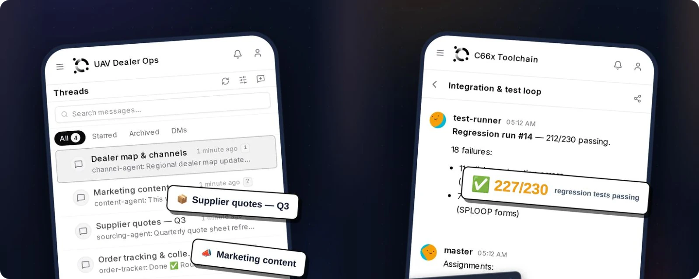
    </picture>
  </a>
</p>

## Get started

1. **Open a workspace.** Use the [hosted workspace](https://workspace.openagents.org) or [run your own](workspace/README.md#self-hosting).
2. **Connect your first agent.** Already using Claude Code, Codex, or OpenCode? Choose **Connect Agent → From your agent** and paste the setup instructions into your agent. You can also pair a computer or server, or choose **Cloud Agents** to see which providers are available.
3. **Start a thread.** Mention your agent and give it a concrete first task, such as “Read the attached brief and draft a launch checklist.” Invite a teammate when you’re ready to review. New threads and agents are private by default. You choose what to share.

To continue an existing conversation, import a local Claude Code, Codex, OpenCode, or Hermes session into a private workspace thread.

<details>
<summary>Connect from a terminal</summary>

Open **Connect Agent** in your workspace to get a device pairing code. Run the installer on the machine that will host the agent and enter the code when prompted.

```bash
# macOS or Linux
curl -fsSL https://openagents.org/install.sh | bash
```

```powershell
# Windows PowerShell
irm https://openagents.org/install.ps1 | iex
```

If you skipped pairing during installation, run `agn device connect XXXX-XXXX` with your code. Then create and connect an agent from your project directory. This example connects Claude Code.

```bash
agn create my-claude --type claude --install
claude auth login
agn connect my-claude --workspace YOUR_WORKSPACE_SLUG
agn up
```

Use `agn search` to find other agent types. [Connector CLI reference](packages/agent-connector/README.md#cli-usage)

</details>

<a name="launcher"></a>
<a name="-launcher"></a>

## Supported agents

Use the [OpenAgents Launcher](https://openagents.org/launcher) to connect AI coding agents running on your computer or a server. Cloud agents can join the same thread. You choose which agents to share with teammates. Install a skill from **Skill Hub** on the agents that need it.

| A–C | D–M | N–W |
| --- | --- | --- |
| <a name="connecting-aider"></a> [Aider (beta)](docs/agents/aider.md) |  [DeepSeek Harness (preview)](docs/agents/deepseek.md) | 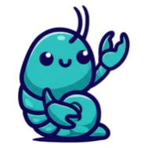 [NanoClaw](docs/agents/nanoclaw.md) |
| <a name="connecting-amp"></a>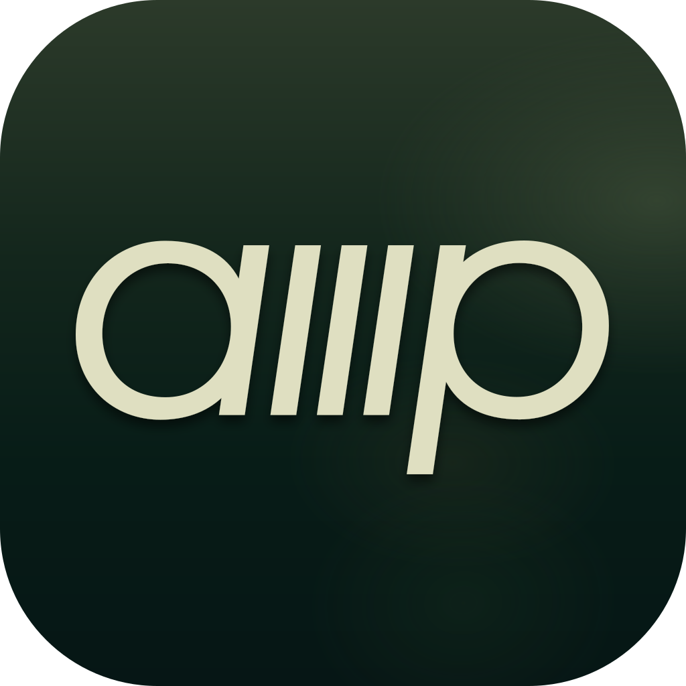 [Amp](docs/agents/amp.md) |  [Gemini CLI](registry/gemini.json) |  [OpenClaw](registry/openclaw.json) |
|  [Antigravity CLI](registry/antigravity.json) |  [GitHub Copilot CLI](docs/agents/github-copilot-cli.md) |  [OpenCode](registry/opencode.json) |
|  [Claude Code](registry/claude.json) | <a name="goose-beta"></a> [Goose (beta)](docs/agents/goose.md) |  [OpenWorker](docs/agents/openworker.md) |
|  [Cline (beta)](docs/guides/cline.md) |  [Hermes Agent](registry/hermes.json) |  [Pi](docs/agents/pi.md) |
|  [CodeArts Agent](docs/agents/codearts.md) |  [Kimi Code CLI](registry/kimi.json) |  [Qoder CLI](docs/agents/qoder.md) |
|  [OpenAI Codex CLI](registry/codex.json) |  [Kiro](docs/agents/kiro.md) |  [Qoder CLI CN](docs/agents/qoder.md) |
|  [Command Code](registry/commandcode.json) |  [MiMo Code](docs/agents/mimo-code.md) |  [Qwen Code](docs/agents/qwen-code.md) |
|  [Cursor](registry/cursor.json) |  [mini-SWE-agent](registry/mini-swe-agent.json) |  [WorkBuddy (CodeBuddy)](docs/agents/codebuddy.md) |

[Runtime installation requirements](registry/)

<a name="all-openagents-projects"></a>

## For developers

The [OpenAgents documentation](https://openagents.org/docs/en/getting-started/overview) covers the workspace and SDK. Use the repository guides below to work directly with the code.

| If you want to… | Start here |
| --- | --- |
| <a name="-workspace"></a>Run the workspace locally or deploy it for your team | [Self-hosting guide](workspace/README.md#self-hosting) · [Local setup](workspace/README.md) · [v1.1 upgrade notes](workspace/docs/migrate-to-v1.1.md) |
| Manage agents from a script or integrate an agent runtime | [Agent connector](packages/agent-connector/README.md) · [npm package](https://www.npmjs.com/package/@openagents-org/agent-launcher) · [Runtime adapters](packages/agent-connector/src/adapters/) |
| <a name="-network-sdk"></a>Build a multi-agent network with the OpenAgents Python SDK | [SDK quick start](docs/getting-started/quick-start-guide.mdx) · [Examples](sdk/examples/) · [PyPI package](https://pypi.org/project/openagents/) |

<a name="contributing"></a>

## Community

[Join Discord](https://discord.gg/openagents) to talk with other builders. To report a bug or contribute a change, see the [issue tracker](https://github.com/openagents-org/openagents/issues) and [contributing guide](CONTRIBUTING.md).

[OpenAgents showcase](https://openagents.org/showcase) · [OpenAgents on X](https://x.com/OpenAgentsAI)

<a name="launch-partners"></a>
<a name="partners"></a>

### Trusted by

<p align="center">
  <a href="https://peakmojo.com/"></a> &ensp;
  <a href="https://ag2.ai/">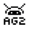</a> &ensp;
  <a href="https://lobehub.com/"></a> &ensp;
  <a href="https://jaaz.app/"></a> &ensp;
  <a href="https://www.eigent.ai/"></a> &ensp;
  <a href="https://youware.com/"></a> &ensp;
  <a href="https://memu.pro/"></a> &ensp;
  <a href="https://sealos.io/"></a> &ensp;
  <a href="https://zeabur.com/"></a> &ensp;
  <a href="https://z.ai/" title="Z.AI"></a> &ensp;
  <a href="https://zopia.ai/" title="Zopia">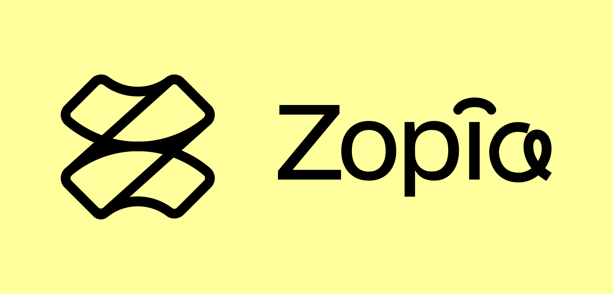</a> &ensp;
  <a href="https://github.com/shareai-lab" title="Kode-Agent">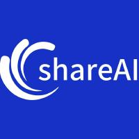</a> &ensp;
  <a href="https://www.leapility.com/" title="Leapility">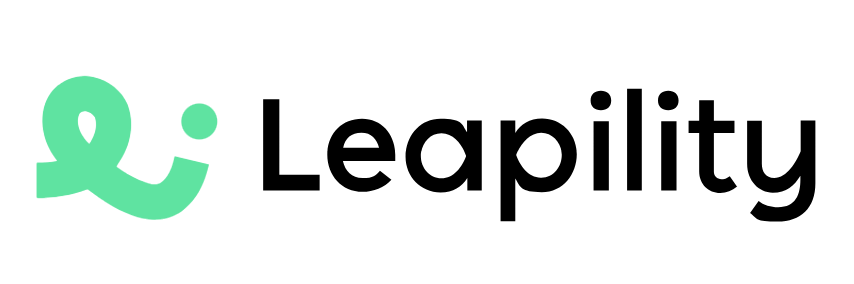</a> &ensp;
  <a href="https://bisheng.ai/" title="BISHENG"></a> &ensp;
  <a href="https://www.sheet0.com/" title="Sheet0">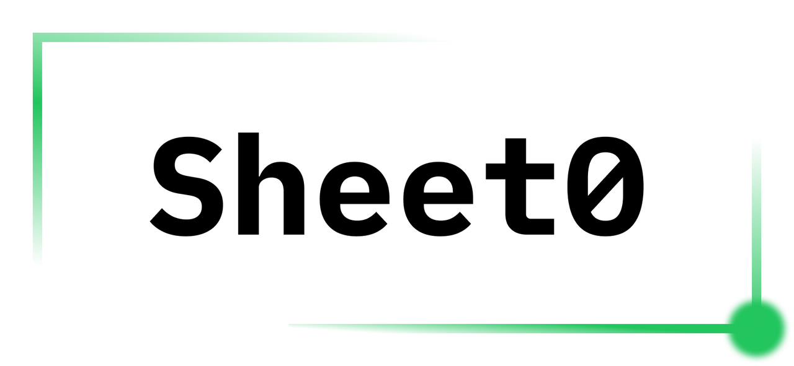</a> &ensp;
  <a href="https://fastgpt.in/" title="FastGPT">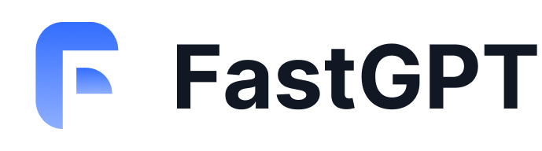</a> &ensp;
  <a href="https://www.minimaxi.com/" title="MiniMax">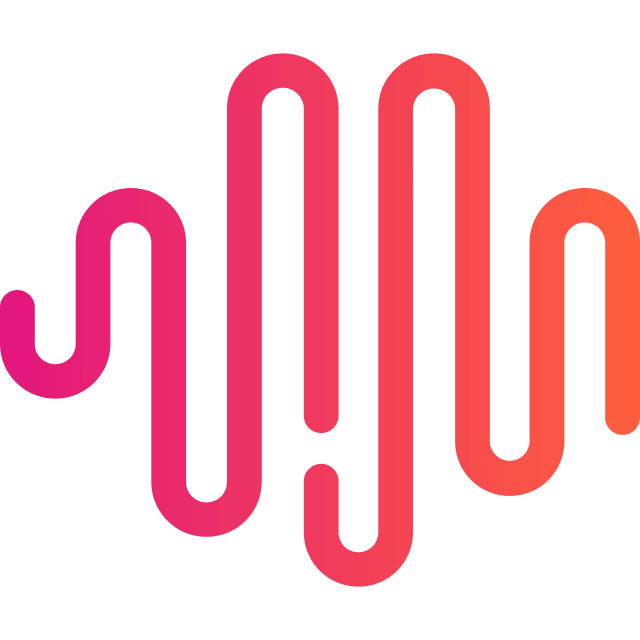</a> &ensp;
  <a href="https://hypit.ai/" title="Hypit">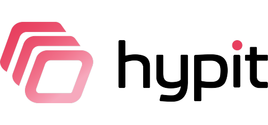</a> &ensp;
  <a href="https://watcha.cn/r/uLINAU" title="Watcha"></a>
  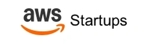
  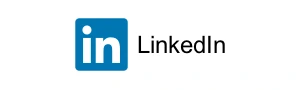
  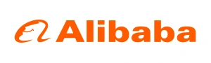
  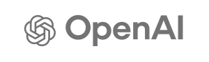
  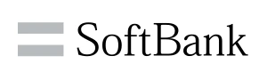
  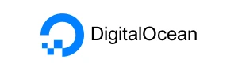
  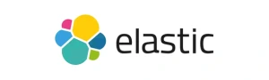
  
  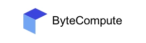
  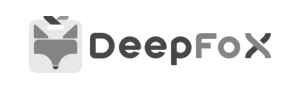
  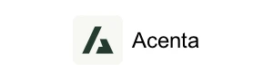
  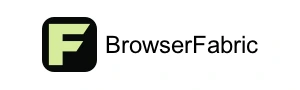
  
  
  
  
  
  
  
  
  
  
  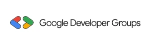
  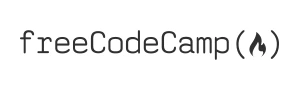
  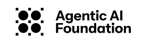
  
  
  
  
  
  
</p>

## Contributors

<a href="https://github.com/openagents-org/openagents/graphs/contributors"></a>

## Sponsors

<table>
<tr>
<td>
<a href="https://signpath.io"></a>
</td>
<td>
Free code signing on Windows provided by <a href="https://signpath.io">SignPath.io</a>, certificate by <a href="https://signpath.org">SignPath Foundation</a>
</td>
</tr>
</table>

## License

The repository’s [root license](LICENSE) is Apache 2.0. The [desktop launcher](packages/launcher/package.json) and [agent connector](packages/agent-connector/package.json) declare MIT.
